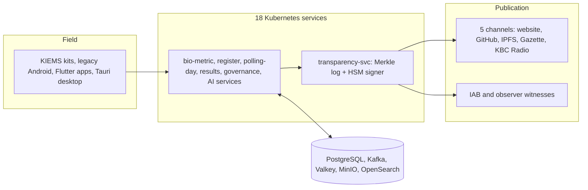

# eel

**An open-source election integrity platform.** It runs the electoral lifecycle — voter registration, biometric deduplication, polling-day identification, results transmission and tally, certification — and, more importantly, it lets anyone independently verify that those results are correct.

Every result traces to a single Merkle transparency log, signed in an HSM and published continuously to five independent channels. The tally is reproducible bit-for-bit from primary evidence by a third party with nothing but this repository. The post-election audit sample is derived from the election data itself by cryptographic sortition, so no operator chooses what gets audited.

This is the code behind that claim. **Read [docs/RATIONALE.md](docs/RATIONALE.md) first** — it explains the failure modes this exists to prevent, the evidence for them, and the reasoning behind each architectural decision. Architecture decisions are recorded individually in [docs/adr/](docs/adr/), including the rejected alternatives and the negative results.

[](LICENSE)
[](rust-toolchain.toml)

Licensed under Apache-2.0. Copyright © 2026 Nyimbi Odero. The identifier prefix `eel` is neutral by design: no class, package, event type, topic, header, or trust domain names any client or partner.

## What this is

- **The full electoral lifecycle.** Voter registration and biometric dedup, polling-day identification, results transmission and tally, declaration and certification, public verification, transparency logging, long-term archive. 69 functional modules across 18 Kubernetes services; every module in the RFP acceptance criteria is implemented, and every edge case in the 118-row edge-case matrix has test coverage linked in [docs/plans/TRACEABILITY.yaml](docs/plans/TRACEABILITY.yaml).
- **Public verifiability.** A single monolithic Merkle transparency log per election with HSM-signed tree heads at 1-second, 60-second, and 5-minute cadences, published on five independent channels (the Commission website, GitHub mirror, IPFS pinned in Kenya, Kenya Gazette daily print anchor, KBC Radio daily hash bulletin). The IAB cosigns from day 1; external observers from day 2. The M14 reproducibility bundle lets any auditor rebuild the entire tally from primary evidence and reach the same Merkle root.
- **Sovereign and highly available.** All data resident in Kenya on Commission-provided infrastructure. T1 election-critical modules run at 99.99% with synchronous DR replication; T2 cycle-critical at 99.9% asynchronous; T3 routine at 99.5%. Five edge clusters (Nairobi, Mombasa, Kisumu, Eldoret, Garissa) serve reads with anycast failover.
- **Hard security floor.** OWASP ASVS L3 on election-critical surfaces, L2 elsewhere. FIPS 140-3 Level 3+ HSMs, post-quantum hybrid signatures (ML-DSA + ECDSA P-384), ML-KEM-768 + X25519 key encapsulation, TLS 1.3 only.
- **Built for every voter.** 11 languages (English, Kiswahili + 9 regional), WCAG 2.2 AA accessibility (AAA for the M68 referendum explainer), offline-first kits with paper backup always available.

## At a glance

| dimension | value |
|---|---|
| Registered voters (target) | 22M+ |
| Polling stations | ~46,229 |
| Constituencies / counties | 290 / 47 |
| KIEMS kits | ~65,000 (~14,100 legacy Android reused) |
| Temporary election staff | ~250,000 |
| Peak concurrent RTS sessions | 60,000 |
| Election-night portal viewers | 5-10M concurrent |
| M13 verifier concurrency | 10M peak |
| Staff check-ins in a 90-minute window | 250,000 |
| Election-day write events | 400-600M |
| Sustained write rate at peak | 30-50k events/sec |
| Extreme burst (evening RTS window) | 80-150k events/sec |
| Audit retention | 15 years |
| Availability | T1 99.99% / T2 99.9% / T3 99.5% |
| Data residency | Kenya (both DR sites, every edge cluster) |
| Voter-facing languages | 11 |
| Accessibility floor | WCAG 2.2 AA (AAA for M68) |
| Security floor | OWASP ASVS L3 election-critical, L2 elsewhere |
| HSM floor | FIPS 140-3 Level 3+ |

## Architecture



### The 18 Kubernetes services

Full per-module pages with every feature, acceptance criterion, and edge case are in [docs/plans/modules/](docs/plans/modules/). Every service has a capability catalogue (`docs/CAPABILITIES.md` under its directory) listing algorithms, source references, implementing crates, and standards satisfied. Operational runbooks are task-based and indexed in [docs/runbooks/README.md](docs/runbooks/README.md).

| service | primary language | tier | modules |
|---|---|---|---|
| [biometric-edge-svc](services/biometric-edge-svc/docs/CAPABILITIES.md) | Rust + Flutter (kits) | T1 | M01 bvr-device, M05 bvi-device, M24 diaspora-voting |
| [bvr-svc](services/bvr-svc/docs/CAPABILITIES.md) | Rust + Django admin | T1 | M02 bvr-backend, M35 cvr, M36 deregistration-appeal, M53 voter-id-card |
| [abis-svc](services/abis-svc/docs/CAPABILITIES.md) | Rust (~80 crates) + Python (6 ONNX sidecars) + confidential compute (TDX/SEV-SNP) | T1 | M03 abis: full multi-modal stack (fingerprint, face, iris, palm, latent, voice, vein, signature, periocular, ear, gait), PAD L2, cancelable templates + FHE + SMPC, NIST harnesses, 25-report catalogue + ad-hoc reports |
| [vprs-svc](services/vprs-svc/docs/CAPABILITIES.md) | Rust + Elixir LiveView | T2 | M04 vprs |
| [bvi-svc](services/bvi-svc/docs/CAPABILITIES.md) | Rust + Elixir LiveView + Astro | T1 | M06 bvi-backend, M07 bvv |
| [rts-svc](services/rts-svc/docs/CAPABILITIES.md) | Rust event-sourced + Tauri desktop | T1 | M08 rts-device, M09 rts-ro, M10 rts-backend, M51 result-declaration, M63 ballot-serial-chain |
| [portal-svc](services/portal-svc/docs/CAPABILITIES.md) | Astro + Elixir LiveView + Rust | T2 | M11 public-portal, M52 election-calendar-gazette, M64 voter-list-inspection, M68 referendum-explainer |
| [crms-svc](services/crms-svc/docs/CAPABILITIES.md) | Rust + Django + Elixir + Python | T2 | M12 crms, M45 party-registration, M46 primaries-oversight, M47 nomination-fee-payment, M67 party-symbol-registry |
| [transparency-svc](services/transparency-svc/docs/CAPABILITIES.md) | Rust + HSM integration | T1 | M14 reproducibility-bundle, M22 campaign-finance, M17 transparency-log anchoring, P05 transparency-log, P06 HSM-signer |
| [ecc-svc](services/ecc-svc/docs/CAPABILITIES.md) | Elixir LiveView + Rust + Python | T2 | M15 iab-dashboard, M16 election-command-centre, M23 grievance-channels |
| [boundary-svc](services/boundary-svc/docs/CAPABILITIES.md) | Rust + PostGIS + Astro | T2 | M18 boundary-transparency |
| [queue-svc](services/queue-svc/docs/CAPABILITIES.md) | Rust + Elixir LiveView + Python CV | T2 | M19 queue-transparency |
| [inventory-svc](services/inventory-svc/docs/CAPABILITIES.md) | Rust event-sourced + Django + Flutter mobile | T2 | M20 inventory-management, M39 ballot-printing-chain, M65 diaspora-logistics |
| [governance-svc](services/governance-svc/docs/CAPABILITIES.md) | Rust + Python + Elixir + Tauri | T2 | M21 rla-audit-tool, M40 election-court-it, M41 post-election-review, M48 recall, M49 referendum, M50 by-elections, M56 county-coordination, M57 observer-coordination, M58 parliamentary-judiciary, M59 oag-interface, M62 transmission-audit, M66 financial-forensics |
| [ai-platform-svc](services/ai-platform-svc/docs/CAPABILITIES.md) | Python (ONNX) + Rust gateway + Flutter kit plugin | T2 | M17 speech-integrity, M26 anomaly-fraud-detection, M28 ai-monitoring-stack, M44 turnout-forecasting, M61 secrecy-assurance |
| [field-mobile-svc](services/field-mobile-svc/docs/CAPABILITIES.md) | Rust BFF + Flutter | T1/T2 | M13 public-verifier-app, M29 citizen-verify, M30 party-agent, M31 poll-clerk, M32 field-support, M33 personnel-dispatch, M34 observer |
| [training-svc](services/training-svc/docs/CAPABILITIES.md) | Django + Flutter offline | T3 | M37 voter-education-cms, M38 poll-worker-training-lms, M42 media-accreditation, M43 observer-accreditation, M60 medical-first-response |
| [support-admin-svc](services/support-admin-svc/docs/CAPABILITIES.md) | Django + Rust + Python | T2 | M25 special-voter-workflows, M27 intent-preservation, M54 budget-expenditure, M55 hr-payroll, M69 long-term-archive |

## The 69 modules

Every module has a full page in [docs/plans/modules/](docs/plans/modules/) with purpose, surfaces, domain model, APIs, events, and acceptance criteria. Ownership matrix: [docs/plans/12-appendix-module-inventory.md](docs/plans/12-appendix-module-inventory.md).

### Voter registration and the register (10)

| M | module | what it does |
|---|---|---|
| M01 | [bvr-device](docs/plans/modules/bvr-device.md) | offline-first biographic and biometric capture on KIEMS kits and legacy Android |
| M02 | [bvr-backend](docs/plans/modules/bvr-backend.md) | authoritative voter register store, ABIS dedup orchestration, register publication |
| M03 | [abis](docs/plans/modules/abis.md) | multi-modal biometric dedup at 30M+ scale inside confidential-compute enclaves |
| M04 | [vprs](docs/plans/modules/vprs.md) | online pre-registration with IPRS identity check and QR handoff token |
| M07 | [bvv](docs/plans/modules/bvv.md) | statutory 30-day public register inspection and objections |
| M25 | [special-voter-workflows](docs/plans/modules/special-voter-workflows.md) | auditable workflows for prisoners, KDF, hospital patients, refugees, IDPs |
| M35 | [cvr-continuous-voter-register](docs/plans/modules/cvr-continuous-voter-register.md) | keeps the register alive between cycles from CRS, NRB, and KRA feeds |
| M36 | [voter-deregistration-appeal](docs/plans/modules/voter-deregistration-appeal.md) | statutory deregistration and appeal workflow with quarterly gazette notices |
| M53 | [voter-id-card](docs/plans/modules/voter-id-card.md) | feature-flagged voter ID card production, collection, and deactivation |
| M64 | [voter-list-public-inspection](docs/plans/modules/voter-list-public-inspection.md) | verifiable roll snapshots and objection intake for the inspection window |

### Polling day (9)

| M | module | what it does |
|---|---|---|
| M05 | [bvi-device](docs/plans/modules/bvi-device.md) | polling-day voter identification and double-voting prevention; paper backup always exists |
| M06 | [bvi-backend](docs/plans/modules/bvi-backend.md) | register extracts, kit provisioning, turnout dashboards, 60-second remote kit lock/wipe |
| M19 | [queue-transparency](docs/plans/modules/queue-transparency.md) | queue length and wait estimation from kit, computer vision, grievance, and USSD signals |
| M20 | [inventory-management](docs/plans/modules/inventory-management.md) | custody tracking for kits, ballots, seals, consumables with seal integrity enforcement |
| M31 | [mobile-poll-clerk](docs/plans/modules/mobile-poll-clerk.md) | companion app for polling clerks: incident logging, queue help, paper-backup guidance |
| M33 | [mobile-personnel-dispatch](docs/plans/modules/mobile-personnel-dispatch.md) | dispatch, GPS check-in/out, and payroll trigger for ~250,000 poll workers |
| M39 | [ballot-printing-chain](docs/plans/modules/ballot-printing-chain.md) | ballot custody from print-run authorisation to station scan-in, RFID sealed |
| M60 | [medical-first-response](docs/plans/modules/medical-first-response.md) | election-day medical incident reporting and dispatch with KRCS, MoH, NDMU |
| M63 | [ballot-serial-chain](docs/plans/modules/ballot-serial-chain.md) | event-sourced serial custody, spoilt ballot recording, end-of-day reconciliation |

### Results transmission and declaration (4)

| M | module | what it does |
|---|---|---|
| M08 | [rts-device](docs/plans/modules/rts-device.md) | Form 34A scan, HSM binding, telco transmission with SMS/USSD fallback |
| M09 | [rts-ro](docs/plans/modules/rts-ro.md) | Returning Officer tallying, Form 34B/34C assembly, dispute adjudication |
| M10 | [rts-backend](docs/plans/modules/rts-backend.md) | signed batch ingest, ICR on scanned tallies, constituency/regional/national snapshots |
| M51 | [result-declaration-certification](docs/plans/modules/result-declaration-certification.md) | HSM-countersigned certificates of election, run-off handling, petition window tracker |

### Public verification and reproducibility (6)

| M | module | what it does |
|---|---|---|
| M11 | [public-portal](docs/plans/modules/public-portal.md) | statutory results portal for 5M concurrent readers with inclusion proofs |
| M13 | [public-verifier-app](docs/plans/modules/public-verifier-app.md) | citizen verification across app, PWA, USSD, WhatsApp, API at 10M concurrency |
| M14 | [reproducibility-bundle](docs/plans/modules/reproducibility-bundle.md) | independently verifiable archive to re-derive every published result |
| M29 | [mobile-citizen-verify](docs/plans/modules/mobile-citizen-verify.md) | pocket verifier with client-side Merkle inclusion proofs via Rust FFI |
| M30 | [mobile-party-agent](docs/plans/modules/mobile-party-agent.md) | party-agent Form 34A match verification with HSM-backed countersignature |
| M34 | [mobile-observer](docs/plans/modules/mobile-observer.md) | structured observation reporting with result verification and countersigning |

### Transparency subjects (3)

| M | module | what it does |
|---|---|---|
| M18 | [boundary-transparency](docs/plans/modules/boundary-transparency.md) | constituency and ward boundaries with provenance, fairness metrics, kit geofences |
| M22 | [campaign-finance-transparency](docs/plans/modules/campaign-finance-transparency.md) | statutory disclosure intake, CBK/FRC cross-reference, public reports |
| M52 | [election-calendar-gazette](docs/plans/modules/election-calendar-gazette.md) | statutory calendar and gazette notices with a legal deadline rule engine |

### Oversight, audit and governance (11)

| M | module | what it does |
|---|---|---|
| M15 | [iab-dashboard](docs/plans/modules/iab-dashboard.md) | Independent Assurance Board real-time window with hardware-key authentication |
| M16 | [election-command-centre](docs/plans/modules/election-command-centre.md) | national situational awareness and dispatch for election leadership |
| M21 | [rla-audit-tool](docs/plans/modules/rla-audit-tool.md) | risk-limiting audits of paper ballots against the digital tally |
| M40 | [election-court-it-interface](docs/plans/modules/election-court-it-interface.md) | 24-hour evidentiary bundle for courts; access architecturally guaranteed, not discretionary |
| M41 | [post-election-review](docs/plans/modules/post-election-review.md) | structured lessons learned with tracked recommendations and a long-drip register |
| M56 | [county-national-coordination](docs/plans/modules/county-national-coordination.md) | MoUs, county dataset approvals, cross-tier incident escalation |
| M57 | [international-observer-coordination](docs/plans/modules/international-observer-coordination.md) | observer missions, briefings, isolated per-mission workspaces |
| M58 | [parliamentary-judiciary-reporting](docs/plans/modules/parliamentary-judiciary-reporting.md) | statutory reports to Parliament and judiciary handover packages |
| M59 | [oag-interface](docs/plans/modules/oag-interface.md) | time-boxed Auditor-General audit engagements with scoped evidence |
| M62 | [transmission-legal-basis-audit](docs/plans/modules/transmission-legal-basis-audit.md) | verifies every RTS transmission event against the statutory rules engine |
| M66 | [election-financial-forensics](docs/plans/modules/election-financial-forensics.md) | econometric detection of anomalous vote-expenditure relationships |

### Parties, candidates and contest types (10)

| M | module | what it does |
|---|---|---|
| M12 | [crms](docs/plans/modules/crms.md) | candidate nomination, statutory clearances, quota rules, signed ballot design packages |
| M24 | [diaspora-voting](docs/plans/modules/diaspora-voting.md) | embassy-hosted BVR/BVI with delayed batch transmission and RFID ballot custody |
| M45 | [party-registration-management](docs/plans/modules/party-registration-management.md) | party registration, annual returns, coalitions under the Political Parties Act |
| M46 | [party-primaries-oversight](docs/plans/modules/party-primaries-oversight.md) | KIEMS-lite primaries kits, integrity dashboards, dispute intake |
| M47 | [nomination-fee-payment](docs/plans/modules/nomination-fee-payment.md) | fee schedules and M-Pesa collection with idempotent Daraja callbacks |
| M48 | [recall](docs/plans/modules/recall.md) | Article 104 recall petitions with signature thresholds and by-election handoff |
| M49 | [referendum-mechanics](docs/plans/modules/referendum-mechanics.md) | referendum tallying with the 24-of-47 county threshold, TLA+ verified |
| M50 | [by-election-operations](docs/plans/modules/by-election-operations.md) | up to 10 concurrent by-elections including short-notice flows |
| M65 | [diaspora-ballot-physical-logistics](docs/plans/modules/diaspora-ballot-physical-logistics.md) | physical custody chain for diaspora ballot materials end to end |
| M67 | [party-symbol-colour-registry](docs/plans/modules/party-symbol-colour-registry.md) | symbol and colour registration with pHash and Delta-E similarity checks |

### AI and analytics (5)

| M | module | what it does |
|---|---|---|
| M17 | [speech-integrity](docs/plans/modules/speech-integrity.md) | incitement and disinformation monitoring with Kenyan-language models |
| M26 | [anomaly-fraud-detection](docs/plans/modules/anomaly-fraud-detection.md) | seven-layer rigging detection stack; every alert routes to a named human |
| M28 | [ai-monitoring-stack](docs/plans/modules/ai-monitoring-stack.md) | governed model registry with five hard red lines around the tally |
| M44 | [turnout-forecasting-analytics](docs/plans/modules/turnout-forecasting-analytics.md) | pre-election forecasts and election-day turnout variance alerts |
| M61 | [secrecy-assurance-testing](docs/plans/modules/secrecy-assurance-testing.md) | red-team engagements on isolated staging clones with IAB attestation |

### Grievances and civic space (6)

| M | module | what it does |
|---|---|---|
| M23 | [grievance-channels](docs/plans/modules/grievance-channels.md) | multi-channel intake (WhatsApp, USSD, SMS, app, kiosk) with triage and routing |
| M27 | [intent-preservation](docs/plans/modules/intent-preservation.md) | ballot design, pre-mark validation, adjudication codes; < 1.0% rejected-ballot target |
| M37 | [voter-education-cms](docs/plans/modules/voter-education-cms.md) | fact-checked voter education in 11 languages and four formats |
| M42 | [media-accreditation-portal](docs/plans/modules/media-accreditation-portal.md) | tamper-evident media credentials with offline badge verification |
| M43 | [observer-accreditation-portal](docs/plans/modules/observer-accreditation-portal.md) | vetting and credentialing for domestic and international observers |
| M68 | [referendum-explainer](docs/plans/modules/referendum-explainer.md) | plain-language, KSL video, and TTS explainers at WCAG 2.2 AAA |

### Workforce and back office (5)

| M | module | what it does |
|---|---|---|
| M32 | [mobile-field-support](docs/plans/modules/mobile-field-support.md) | field engineer console: ticket SLAs, remote kit diagnostics, warranty claims |
| M38 | [poll-worker-training-lms](docs/plans/modules/poll-worker-training-lms.md) | cascaded training and certification for ~250,000 poll workers |
| M54 | [budget-expenditure](docs/plans/modules/budget-expenditure.md) | budgets, procurement, IFMIS/PPRA reporting with separation of duties |
| M55 | [hr-payroll](docs/plans/modules/hr-payroll.md) | hiring through M-Pesa disbursement; 250k payruns in under 4 hours |
| M69 | [long-term-archive](docs/plans/modules/long-term-archive.md) | BagIt archives, DataCite DOIs, preservation attestations, destruction certificates |

## Shared packages

Cross-language libraries under `packages/` provide auth, secrets, events, persistence, observability, and resilience foundations. Core libraries ship as per-language crates/modules (`-rs`, `-py`, `-ex`); see [packages/README.md](packages/README.md).

| package | languages | purpose |
|---|---|---|
| eel-auth | Rust, Python, Elixir | JWT verification, SpiceDB client, audit trail, OpenTelemetry integration |
| eel-secrets | Rust, Python, Elixir | OpenBao dynamic credentials, transit encryption, key rotation |
| eel-events | Rust, Python, Elixir | Event envelope, producer/consumer, message signing |
| eel-outbox | Rust, Python, Elixir | Transactional outbox pattern, Kafka publisher, idempotency |
| eel-eventstore | Rust, Python, Elixir | Event aggregate, chain history, snapshots, replay |
| eel-pii | Rust, Python, Elixir | Typed PII wrappers (Restricted, Sensitive, Public), masking |
| eel-hlc | Rust, Python, Elixir | Hybrid logical clock, causality tracking, merge semantics |
| eel-resilience | Rust, Python, Elixir | Circuit breakers, bulkheads, idempotency middleware, graceful degradation |
| eel-observability | Rust, Python, Elixir | OpenTelemetry spans, SLO metrics, audit shadow, structured logging |
| eel-loadshedding | Rust, Python, Elixir | Priority-based load shedding, adaptive admission control |
| eel-crypto | Rust | PKCS#11 HSM bindings, Ed25519, post-quantum hybrid (ML-KEM + ML-DSA), cosign, Merkle trees |
| eel-api-server | Rust | Opinionated axum application builder, middleware stack, health checks |
| eel-audit-chain, eel-trace, eel-spec-helpers | Rust | Append-only audit chain, trace context, spec test helpers |
| eel-web | Python, Astro | Django base application and admin UI; Astro static site base with design-system components |
| verifier | Rust (Dart FFI + WASM) | Merkle inclusion proof and Signed Tree Head verification (libeel-verifier) |
| kit-sdk | Flutter | Shared kit firmware shell, secure enclave storage, device attestation, offline event queue |
| service-template | Rust, Python, Elixir | Scaffolding for new services, CI/CD hooks, test skeleton |
| design-system | Astro, Svelte, Django | Component library, tokens, accessibility guidelines |
| openapi-contracts | OpenAPI 3.1 | Canonical API specifications, contract testing |
| event-schemas | JSON Schema | Event message specifications, evolution rules |
| authz-schema | SpiceDB .zed | Domain authorization policies, permission model definitions |
| data-dictionary | YAML | Column classification schema, PII types, retention policies |
| api-clients | Dart, TypeScript, Python, Rust | Auto-generated client libraries for all services |
| i18n | Message catalogs | 11-language translations (English, Kiswahili + 9 regional) |

## Technology stack

### Languages

| component | version/role | purpose |
|---|---|---|
| Rust | nightly (stable fallback) | T1 services, HSM bindings, cryptography, performance-critical paths |
| Python | 3.12 + uv | ML/AI, adapters, batch jobs, Django admin surfaces |
| Elixir + OTP | 1.17 + OTP 27 | LiveView dashboards, messaging, soft-real-time event processing |
| Dart + Flutter | 3.2.x | Kit firmware, mobile apps (Android, iOS, PWA), Tauri desktop |
| TypeScript + Node | 22 + pnpm | Astro static sites, API client generation, browser-side verification |
| Bash + Perl | POSIX | Scripting, migrations, data transforms |

### Data stores

| component | version/role | purpose |
|---|---|---|
| PostgreSQL | 17 | T1-voter (registration, biometrics), T1-consensus (results), T1-audit, T2-shared |
| Kafka + KRaft | 3.7.x | Event bus, transactional outbox CDC, 90-day hot retention, MirrorMaker 2 DR sync |
| Karapace | latest | JSON Schema registry, Kafka topic schema validation |
| Valkey | 8 | Cache, session store, idempotency keys, rate limits |
| OpenSearch | 2.x | Full-text and geo-spatial search (M07, M18, M22, M52) |
| MinIO | RELEASE | S3-compatible object store, tiered Kafka storage, snapshot exports |
| Rook-Ceph | latest | Persistent block/object/file storage for DB, MinIO, Kafka |

### Identity and crypto

| component | version/role | purpose |
|---|---|---|
| Keycloak | 24 | OAuth2/OIDC, SAML, WebAuthn, hardware keys (YubiKey, FIDO2) |
| SPIFFE/SPIRE | 1.9.x | Workload identity, pod/kit/mobile SVIDs, HSM-sealed root |
| SpiceDB | 1.31.x | Google Zanzibar implementation, relational permissions |
| OpenBao | 2.x | Secrets engine, dynamic DB creds, PKI, transit encryption |
| Hardware HSM | PKCS#11 + KMIP | Thales Luna 7 or Utimaco CryptoServer, FIPS 140-3 L3+, STH signing |
| SoftHSM | 2.x | Development/test substitute |

### Mesh and networking

| component | version/role | purpose |
|---|---|---|
| Kubernetes | 1.31 | Container orchestration, StatefulSets for the data tier |
| Cilium | 1.15.x | CNI, service mesh, NetworkPolicy, Hubble observability, eBPF dataplane |
| Envoy | latest | L7 proxy, load balancing, traffic shaping |
| Kong OSS | latest | API gateway, rate limiting, request logging |
| cert-manager | latest | TLS certificate lifecycle, auto-renewal |

### Platform and observability

| component | version/role | purpose |
|---|---|---|
| ArgoCD | 2.11.x | GitOps, ApplicationSets per service x site, blue-green deployments |
| Prometheus + Mimir | latest | Metrics scraping, SLO alerting, long-term retention |
| Loki + Vector | latest | Structured log aggregation, node-level collection |
| Tempo | latest | Distributed tracing backend, trace correlation |
| Grafana | latest | Visualisation, dashboards, SLO tracking |
| OpenTelemetry | latest | Instrumentation SDK, span/metric/log emissions |

### Security and scanning

| component | purpose |
|---|---|
| Falco, Tetragon | Runtime and eBPF threat detection |
| Wazuh + Sigma rules | SIEM, log analysis, detection-as-code |
| Canary tokens | Early breach detection |
| Semgrep, Bandit, Sobelow | SAST for Python, Rust, JavaScript, Elixir |
| cargo-audit, cargo-deny | Rust dependency vulnerability and policy scanning |
| Trivy, Grype | Container and SBOM-based vulnerability matching |
| Nuclei, ZAP | DAST templates, web penetration testing |
| MobSF | Mobile app static analysis (Android + iOS) |

### Testing

| component | purpose |
|---|---|
| cargo-nextest, pytest, ExUnit, flutter_test, vitest | Unit runners for all five languages |
| proptest, hypothesis, StreamData, fast-check | Property-based testing |
| Pact Broker, Karapace, openapi-diff, buf | Consumer-driven contracts and schema breaking checks |
| testcontainers | Ephemeral DB/Kafka/Valkey integration tests |
| Patrol, Playwright, tauri-driver, kit-simulator | E2E for mobile, portal, desktop, and 65k virtual kits |
| cargo-fuzz, libFuzzer | Fuzzing every codec and protocol boundary |
| TLA+ / Apalache, kani, creusot | Formal verification of tally logic, Merkle trees, HLC |
| k6, Gatling, election-day simulator | Load testing to 5x peak, 80k ev/s bursts |
| Chaos Mesh | Failure injection, monthly pre-prod drills |
| cargo-mutants, mutmut, Stryker | Mutation testing, 75%+ kill rate on election-critical |

### Build and supply chain

| component | purpose |
|---|---|
| Nix (flakes) | Reproducible builds, bit-identical rebuilds, dev environments |
| Sonatype Nexus OSS | PyPI, npm, cargo, Maven, apt, OCI, hex mirrors |
| Forgejo / Gitea + Woodpecker CI | On-prem git hosting, event-driven CI/CD |
| cosign, SLSA L3, in-toto, syft, RFC 3161 | Image signing, provenance attestations, SBOM, timestamping |
| Kyverno, OPA Gatekeeper | Admission control: signed images, SVID attestation, namespace isolation |

## Statutes and regulations satisfied

- Constitution of Kenya, Article 87: right of election petition
- Constitution of Kenya, Article 104: recall procedure
- Elections Act 2011 (amended): sections 6A (public inspection), 14A (extended hours), 30 (nomination), 39(1C) (transmission), 44 (identification), 44A (complementary mechanism), 53-55 (spoilt ballots), 69 (offences), 72 (secrecy), 75(1) (election courts), 78 (offences reporting), 80 (recount and scrutiny), 83-84 (declaration and certificate)
- Elections (Technology) Regulations 2017: KIEMS certification, transmission audit, independent security certifier
- Election Offences Act: criminal liability provisions
- Election Campaign Financing Act (ECFA): disclosure, reporting, limit enforcement
- Political Parties Act 2011 (amended 2022): registration, primaries, symbol management
- Kenya Data Protection Act 2019: sections 26 (minimisation), 40 (right to erasure), 41 (automated processing), 71 (cross-border transfer)
- ISO/IEC 27001:2022: information security management system (mandated by tender section V)
- ISO/IEC 17799: legacy information security reference standard
- Kenya Information and Communications Act (KICA): digital security requirements
- Data-sharing protocols with NLC, KNBS, IPRS, county governments (MoU-driven)

## Local development

```bash
# Clone and enter the repository
git clone https://github.com/Datacraft-GaaS/elections && cd elections

# Load the Nix development environment (Rust, Python 3.12, Elixir/OTP, Dart, Node 22)
nix develop

# Or load a single language environment
nix develop .#rust
nix develop .#python
nix develop .#elixir
nix develop .#dart
nix develop .#node
```

| command | what it does |
|---|---|
| `just up` | Full local stack: kind cluster on `127.0.0.1:6443` with Kafka, PostgreSQL (Patroni), Valkey, MinIO, OpenSearch, Keycloak, SpiceDB, OpenBao, SPIRE, SoftHSM, Cilium, Prometheus/Loki/Grafana. First run takes 3-5 minutes. |
| `just synth --scale 100k` | Generate deterministic synthetic test data (voter register, no real PII) |
| `just seed` | Load synthetic data into the cluster (runs `synth` first) |
| `just contracts` | Spectral OpenAPI linting, Karapace schema validation, SpiceDB golden tests |
| `just test` | cargo-nextest, pytest, ExUnit, flutter_test, vitest |
| `just lint` / `just fmt` | Lint and format across all languages |
| `just ci` | Full local CI: lint, test, contracts |
| `just down` | Tear down the stack |

### Troubleshooting

**`nix develop` fails with "unknown attribute"**
Check your Nixpkgs version and ensure you're on the stable channel. The flake pins to nixpkgs-unstable; edit `flake.lock` if you need a specific version.

**`just up` times out**
Cluster bootstrap can take 3-5 minutes on first run. Kafka needs at least 6 GB free disk and 4 GB available RAM. Check logs with `kubectl logs -n kube-system -l app=coredns`.

**Services cannot reach PostgreSQL**
Verify Patroni is running (`kubectl get pods -n postgres`) and DNS resolves: `kubectl run -it --rm debug --image=busybox --restart=Never -- nslookup postgres.default.svc.cluster.local`.

**Keycloak realm not loading**
Wait for the init Job (`kubectl logs -n keycloak -f job/keycloak-init`). Realm bootstrap takes ~30 seconds on first run.

## Development waves and gates

Seven waves cover the build from toolchain setup through full-system verification. Wave plans: [docs/plans/01-wave-0-toolchain.md](docs/plans/01-wave-0-toolchain.md) through [docs/plans/07-wave-6-verification.md](docs/plans/07-wave-6-verification.md).

| wave | focus | gate | commits |
|---|---|---|---|
| G0 | Toolchain, local profile, contracts, CI | PASS |
| G1 | 43 shared packages, templates, platform base | PASS |
| G2 | Trust core: transparency log, HSM signer, IAM, boundary, tier-A integrations | PASS |
| G3 | Election-night critical path: rts, bvr, abis, bvi, kits, portal, load harness | PASS |
| G4 | Operations, oversight, AI, mobile suite, register surfaces, candidates, edge, observability | PASS |
| G5 | Governance long tail, training, support-admin, diaspora, chaos/DR, runbooks, compliance, reproducibility, manifests, handover | PASS |
| G6 | Full-system verification: rehearsal, DR drill, chaos suite, 5x load, security harness, a11y/i18n sweep, completeness audit | PASS | 6c6901e, b36c1f7, d08e8a9, 0808d20 |
| G7 (ongoing) | ABIS world-class expansion: ~80 abis-svc crates, 6 Python ONNX sidecars, 25-report catalogue, ad-hoc reports with DOCX/Markdown export | LIVE | adf02d2, 6033737, 5d80e22, dd1904c, 7320dc9, 6f9b57d, 3de64cb, 2123b46, fab0580, aab9afb |

### ABIS world-class extension

Beyond G6, an ABIS excellence sweep took M03 to full parity with leading commercial ABIS (Idemia MorphoBIS, NEC NeoFace, Innovatrics ABIS, Neurotechnology MegaMatcher). Every capability is a native implementation or a standards-aware vendor abstraction. Full catalogue: [services/abis-svc/docs/CAPABILITIES.md](services/abis-svc/docs/CAPABILITIES.md).

| domain | highlights |
|---|---|
| Fingerprint | MCC + CDEFFS extended features, Level-3 pores/edges, Bozorth + K-plet, 5-matcher consensus with Platt calibration, SourceAFIS native Rust reimplementation, NFIQ 2.2, DeepPrint ONNX, NIST FpVTE/PFT-III harness |
| Face | RetinaFace detection, ArcFace/AdaFace/CosFace embedders via ONNX, ISO/IEC 29794-5 quality, Basel Face Model 3DMM pose normalisation, visible/NIR/thermal cross-domain, mask and hijab robustness, NIST FRVT harness |
| Iris | Daugman integro-differential + OSIRIS refinement, 2D Gabor + PIE encoders, ISO/IEC 29794-6 quality, contact-lens detection, left+right + periocular fusion, DeepIrisNet, NIST IREX harness |
| Other modalities | palm, latent (ANSI/NIST-ITL Type-13), voice MFCC, vein, signature DTW, periocular, ear, gait, sub-100us watchlist |
| PAD Level 2 | 7 detectors (multispectral fingerprint, passive and challenge-response face, iris pupil dynamics, voice replay/synthesis, LivDet, deepfake) with ISO/IEC 30107-3 APCER/BPCER gates |
| Template protection | BioHash, random projection, fuzzy vault, fuzzy commitment, Bloom shielding, homomorphic encryption (CKKS/BFV/TFHE/BGV), SMPC (SPDZ/BGW/GMW/Yao) |
| Operations | Threshold tuning with bootstrap 95% CI, blue-green model canary with auto-rollback, drift monitor (PSI/KS/JS/Wasserstein), 7-worker bulk ops, twin registry, GPU/FPGA accelerator traits |
| Reports | 25 seeded report definitions (operational, statistical, regulatory, legal, public, financial, executive) with cron scheduling, per-format renderers (JSON/CSV/Parquet/PDF/HTML/PNG/XLSX/DOCX/Markdown), HSM signing, transparency-log anchoring, 7-channel delivery, plus ad-hoc reports with SQL AST validation and Monaco/Django editors |

## Testing pyramid

Run the Rust unit suites with `just test-unit`, which walks every workspace root
and propagates the first failure.

| layer | frameworks | coverage target | status |
|---|---|---|---|
| Unit (Rust) | cargo-nextest / cargo test | >= 80% per service | **1,185 passing** across 10 workspace roots |
| Unit (Python) | pytest | >= 80% per service | **1,362 passing** across 14 projects |
| Unit (Elixir) | ExUnit | >= 80% per service | **99 passing** across 7 projects |
| Unit (Dart, TypeScript) | flutter_test, vitest | >= 80% per service | need Flutter and Node toolchains |
| Property | proptest, hypothesis, StreamData, fast-check | >= 20 edge cases per invariant | in-tree |
| Contract | Pact Broker, Karapace, openapi-diff, buf breaking | 100% service pair coverage | needs broker / cluster |
| Integration | testcontainers | all read/write paths | needs Docker |
| E2E | Patrol, Playwright, tauri-driver, kit-simulator | all user flows | needs cluster + devices |
| Fuzz | cargo-fuzz, libFuzzer | every codec and protocol boundary | needs nightly |
| Formal | TLA+ / Apalache, kani, creusot | safety and liveness properties | needs kani / Apalache |
| Load | k6, Gatling, election-day simulator | 5x peak weekly, 80k ev/s bursts | needs cluster |
| Chaos | Chaos Mesh | monthly pre-prod drill | needs cluster |
| Security | Semgrep, Bandit, cargo-audit, Trivy, Grype, ZAP, Nuclei, testssl.sh | ASVS L3 election-critical, L2 elsewhere | `cargo audit` + `cargo deny check` run locally |
| Accessibility | axe, manual screen-reader scripts, 11-language pseudo-locale | WCAG 2.2 AA (AAA for M68) | needs browser |
| Reproducibility | Nix flakes, bit-identical rebuild, hash manifest | M14 make-reproduce v2 | needs Nix |
| Mutation | cargo-mutants, mutmut, Stryker | 75%+ kill rate on election-critical | hours of CPU |

Only the unit rows are verified by a single command. The rest are real suites
with real assertions, but they require infrastructure this repository does not
ship — treat them as available, not as evidence.

### Prerequisites for the unit suites

```bash
# Rust and Python need nothing beyond the pinned toolchain and uv.
# Elixir additionally needs erl on PATH (Homebrew installs it unlinked):
export PATH="/opt/homebrew/opt/erlang/bin:$PATH"

# If cargo reports "Failed to determine realpath of .../MacOSX26.5.sdk",
# the ambient SDKROOT points at an SDK that is not installed:
export SDKROOT="$(ls -d /Applications/Xcode.app/Contents/Developer/Platforms/MacOSX.platform/Developer/SDKs/MacOSX*.sdk | tail -1)"
```

## Security and trust model

Election-critical systems (T1, 99.99%) are built to OWASP ASVS Level 3; others to Level 2. Cryptography uses FIPS 140-3 Level 3+ HSMs, post-quantum hybrid signatures (ML-DSA + ECDSA P-384), and ML-KEM-768 + X25519 key encapsulation. TLS 1.3 only, with HSTS, DANE, and ECH where supported.

The transparency model is a single monolithic Merkle log per election. Leaves are domain-tagged; Signed Tree Heads are HSM-signed at 1-second, 60-second, and 5-minute cadences and published on five channels: the Commission website, GitHub mirror, IPFS pinned in Kenya, Kenya Gazette daily print, and KBC Radio hash bulletin. The IAB cosigns from day 1; external observers from day 2. The M14 reproducibility bundle allows a bit-identical rebuild.

Details: [docs/architecture/cross-cutting/trust-model.md](docs/architecture/cross-cutting/trust-model.md).

## Reproducibility

Every build is reproducible. The M14 bundle lets builders, auditors, and courts independently re-derive and verify the tally without access to the source repository. Pipeline: fetch bundle, Nix rebuild, diffoscope compare, tally replay, transparency-log attestation. See [reproducibility/README.md](reproducibility/README.md).

```bash
# Full reproduction pipeline against a release bundle
cd reproducibility/make-reproduce
make reproduce BUNDLE=/path/to/eel-release.tar.gz

# Replay the tally only (fast path for auditing results)
make replay-tally BUNDLE=/path/to/eel-release.tar.gz
```

## Contributing

- **No client names in code**: use the `eel` prefix for packages, events, topics, headers, and trust domains. The client is referred to only as "the Commission", and only in prose.
- **No em/en dashes**: use commas, colons, or periods. This file and all documentation enforce this.
- **Commit conventions**: conventional commits (feat, fix, docs, refactor, test, chore). Include module IDs and ticket refs where applicable.
- **DCO sign-off**: all commits must include `Signed-off-by: Your Name <your.email@example.com>` (`git commit -s`).
- **PR checklist**: link relevant module pages, include acceptance criteria, declare breaking changes, add test IDs to the PR body.
- **Code of conduct**: follow the [Contributor Covenant](https://www.contributor-covenant.org/).

## Licence

Licensed under the Apache License 2.0. Copyright: Datacraft (builder) and the electoral authority of Kenya (commissioning agency).

```
Licensed under the Apache License, Version 2.0 (the "License");
you may not use this file except in compliance with the License.
You may obtain a copy of the License at

    http://www.apache.org/licenses/LICENSE-2.0

Unless required by applicable law or agreed to in writing, software
distributed under the License is distributed on an "AS IS" BASIS,
WITHOUT WARRANTIES OR CONDITIONS OF ANY KIND, either express or implied.
See the License for the specific language governing permissions and
limitations under the License.
```

## Contact and support

Operational on-call rotations, break-glass custodians, and escalation contacts: [docs/runbooks/break-glass.md](docs/runbooks/break-glass.md).

Module ownership and wave assignment: [docs/plans/12-appendix-module-inventory.md](docs/plans/12-appendix-module-inventory.md).

For general inquiries about the Commission Electoral Technology Programme, contact the Commission ICT directorate.