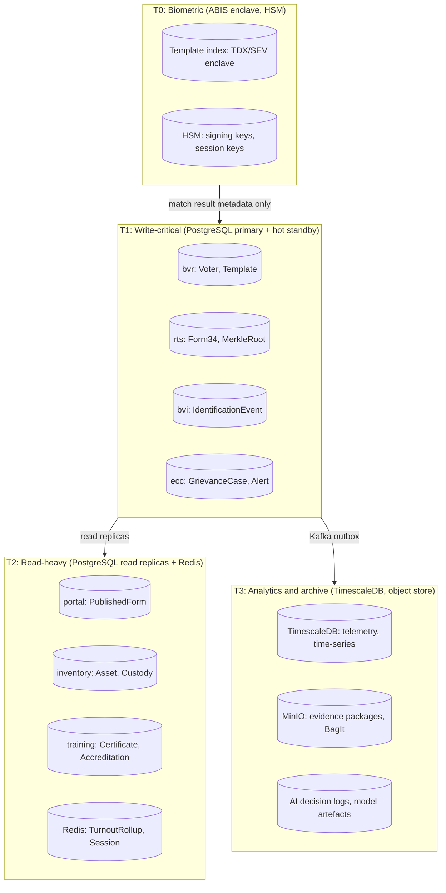

# Data Tiers

## Storage Topology (ADR-0003, ADR-0012)

## PII Tier Summary

| Tier | Label | Data class | Retention policy |
|---|---|---|---|
| T0 | Biometric | Templates, raw captures | Enclave only; deleted on voter request or deregistration |
| T1 | Personal | NID, name, DoB, phone | 10 years post-election (Elections Act s.44) |
| T2 | Operational | Station, ward, kit serial | 7 years |
| T3 | Aggregate | Turnout counts, audit hashes | Indefinite (public record) |

## Event Sourcing vs State-Based (ADR-0013)

Services using event-sourcing (append-only PostgreSQL + Kafka outbox):
- rts-svc (Form34, MerkleRoot, Declaration)
- bvr-svc (Voter, Template, AuditEvent)
- bvi-svc (IdentificationEvent, KitCert)
- transparency-svc (Bundle, ParticipationToken)
- governance-svc (EvidenceBundle, TransmissionEvent)

State-based services (mutable PostgreSQL with audit log):
- crms-svc, vprs-svc, training-svc, support-admin-svc, inventory-svc

## Schema Evolution (ADR-0014)

All PostgreSQL schemas use additive-only migrations via `sqlx` (Rust) or Alembic (Python). No column renames or type changes without a two-phase migration. Kafka topic schemas are versioned in `packages/event-schemas/` with backward-compatible evolution enforced by the schema registry.

## Data Sovereignty

All T0/T1 data resides on Kenyan-hosted infrastructure (primary the Commission DC + mirror). No T0/T1 data transits international networks except diaspora station batches (encrypted in transit and at rest with HSM-derived keys).
