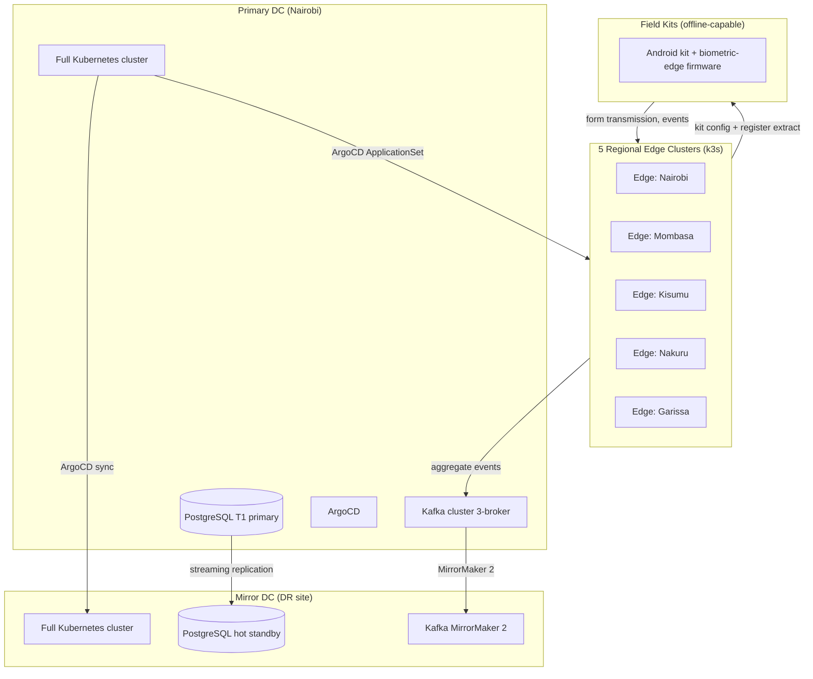

# Deployment Topology

## Site Layout (ADR-0004, ADR-0019, ADR-0022)

## Cluster Responsibilities

| Site | Role | Services hosted |
|---|---|---|
| Primary | Write path, T1 PostgreSQL, Kafka broker | All 18 services |
| Mirror | Hot standby DR, read path during failover | All 18 services |
| Edge (x5) | Kit-proximate BVI/RTS write acceptance, CDN origin | bvi-svc, rts-svc (ingest only), portal-svc (CDN) |
| Kit device | Offline biometric edge | biometric-edge firmware only |

## Failover (ADR-0022)

- RTO: 15 min (automated Argo Rollout promotion + PG promote via pgBackRest).
- RPO: zero for T1 event-sourced data (Kafka + outbox); up to 1 h for T3 analytics.
- Election-day mode freezes schema migrations and disables non-critical background jobs.
- Blue-green deployment for stateful services; canary for portal-svc and vprs-svc.

## Network Paths

- Kit to edge: HTTPS/mTLS over cellular (4G/3G/2G fallback) with SMS compression for form transmission.
- Edge to primary: dedicated private WAN link; satellite backup for Garissa/Mandera edges.
- Primary to mirror: 10 Gbps private link; sub-second replication lag target.
- Public API: CDN (Cloudflare) in front of edge clusters for portal and public APIs.

## ArgoCD ApplicationSets

ApplicationSets in `platform/argocd/applicationsets/` generate one Argo Application per service per site. Election-day-mode policy is applied via Argo Rollout analysis templates that check the `eel.election-day-mode` ConfigMap before promoting.
