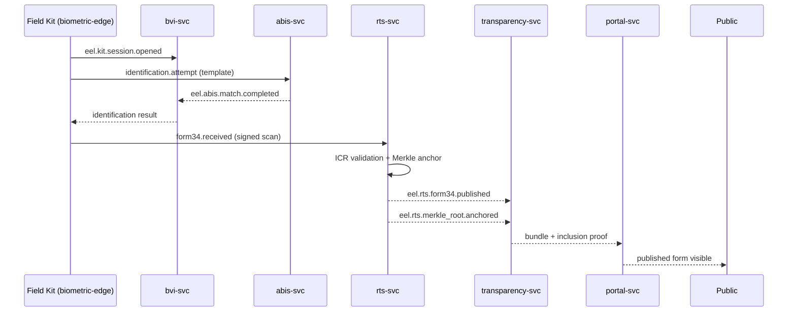
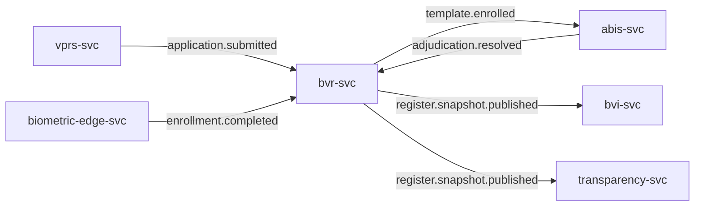
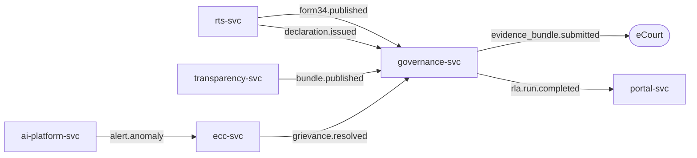

# Event Flow

All inter-service communication flows through Kafka topics following the CloudEvents v1 schema defined in `packages/event-schemas/`. The outbox pattern (eel-outbox-*) guarantees at-least-once delivery; consumers are idempotent.

## Topic Naming

`eel.<service>` - one topic namespace per service. Examples: `eel.rts`, `eel.bvr`, `eel.bvi`, `eel.ecc`.

## Election-Day Critical Path

## Register and Enrolment Flow

## Governance and Audit Flow

## Disaster Recovery Event Replication

MirrorMaker 2 replicates all `eel.*` topics from primary to mirror site with sub-second lag. Edge clusters consume from the nearest regional mirror. See [deployment-topology.md](deployment-topology.md).
