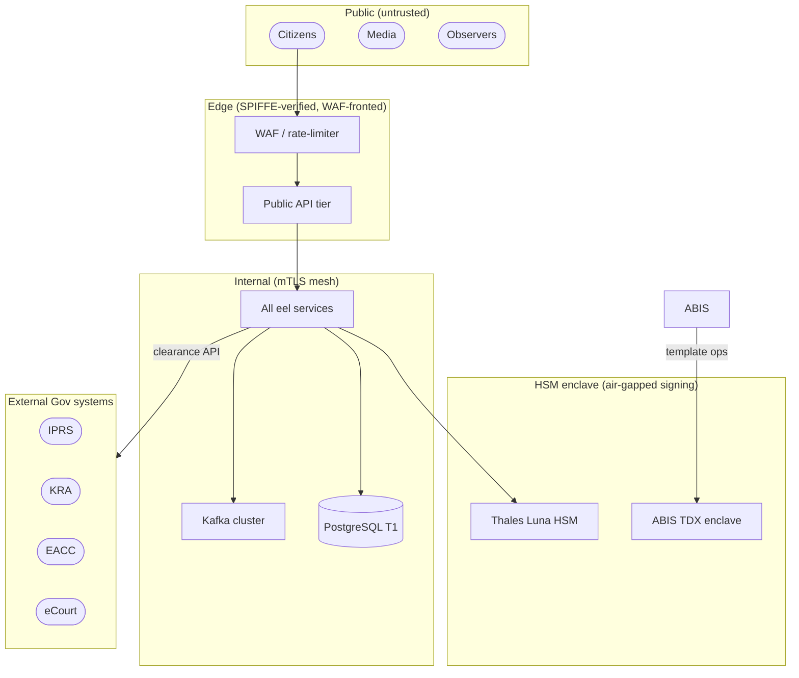

# Trust Model

## Identity: SPIFFE / SPIRE

Every workload receives a SPIFFE Verifiable Identity Document (SVID) from the cluster SPIRE agent. SVIDs encode `spiffe://eel.cluster/<namespace>/<service-account>`. mTLS is mandatory for all inter-service calls; plain HTTP is blocked at the mesh layer.

## Authorization: SpiceDB

Coarse-grained access control (service-to-service and user-to-resource) is enforced by SpiceDB using the schema in `packages/authz-schema/`. Every write path checks a SpiceDB permission before acting.

## Trust Zones

## PII Tier Enforcement

PII classification is enforced by the eel-pii-* libraries at the field level. Tiers:

| Tier | Examples | Storage rule |
|---|---|---|
| T0 | Biometric templates | Enclave or HSM-encrypted only |
| T1 | National ID, name, date of birth | Encrypted at rest, access audited |
| T2 | Polling station, ward | Standard encryption, no special access log |
| T3 | Aggregated counts, turnout | Public read, no restrictions |

## HSM Roles

- Signing key for Form 34* and Merkle roots: owned by RTS HSM partition.
- Certificate signing for kits and workers: owned by BVR/Training HSM partition.
- Enclave session keys: derived per ABIS session via HSM PKCS#11 interface.

## Kit Attestation

Each field kit presents a device certificate issued by the inventory HSM partition. BVI-svc validates the certificate and revokes it (within 60 s) if the device is decommissioned or reported lost.

## External System Trust

External government APIs (IPRS, KRA, EACC, eCourt) are accessed via dedicated integration adapters in `integrations/`. Each adapter uses a client certificate issued by the external authority or a service account token. No external system receives raw biometric data.

## Related ADRs

- ADR-0005 (crypto and HSM), ADR-0007 (authn/authz), ADR-0010 (edge WAF), ADR-0011 (public API surface)
