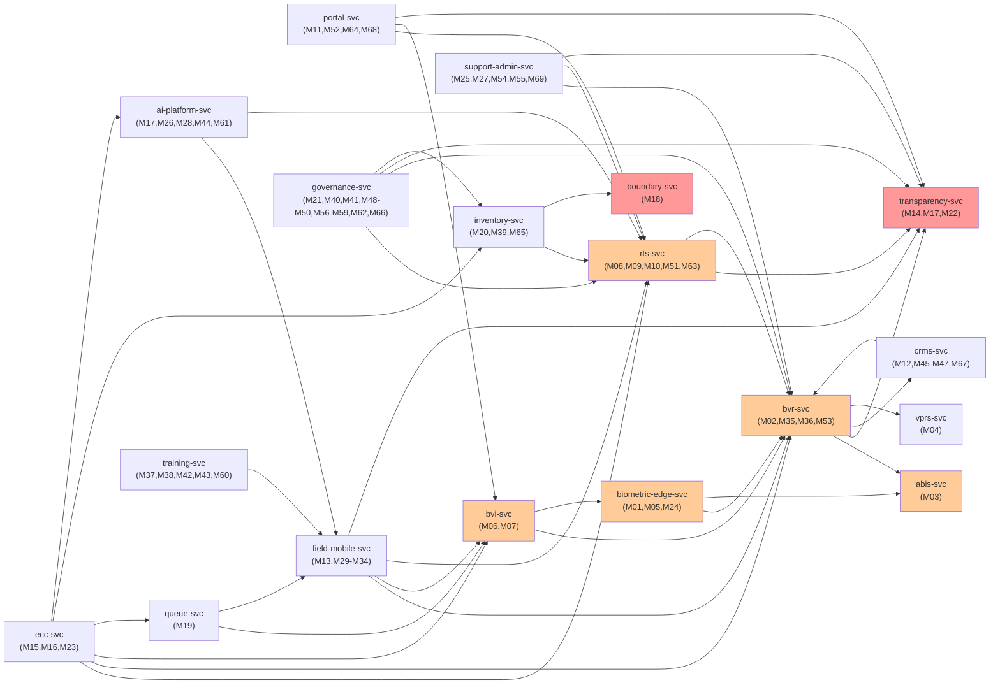

# Services directory

The 18 Kubernetes services below implement the 69 modules of the electoral platform. Each service owns a set of modules, publishes events to Kafka via the transactional outbox pattern, and exposes APIs in OpenAPI 3.1 format. Services are deployed identically across the primary and DR sites, plus regional edge clusters where relevant. Full runbooks and deployment configurations are co-located in each service directory.

| service | purpose | tier | languages | modules | deploy | runbook | dashboard |
|---|---|---|---|---|---|---|---|
| biometric-edge-svc | Kit firmware for voter biometric capture and diaspora voting | T1 | Rust, Flutter | M01, M05, M24 | [deploy/base](biometric-edge-svc/deploy/base) | [docs/runbooks/biometric-edge-svc.md](../docs/runbooks/biometric-edge-svc.md) | [Grafana](http://grafana.default.svc.cluster.local/d/biometric-edge) |
| bvr-svc | Voter register, continuous roll, deregistration appeals, voter ID cards | T1 | Rust, Django | M02, M35, M36, M53 | [deploy/base](bvr-svc/deploy/base) | [docs/runbooks/bvr-svc.md](../docs/runbooks/bvr-svc.md) | [Grafana](http://grafana.default.svc.cluster.local/d/bvr) |
| abis-svc | Biometric matching and duplicate detection on encrypted data | T1 | Rust, Python | M03 | [deploy/base](abis-svc/deploy/base) | [docs/runbooks/abis-svc.md](../docs/runbooks/abis-svc.md) | [Grafana](http://grafana.default.svc.cluster.local/d/abis) |
| vprs-svc | Voluntary Performers Register System, staff accreditation | T2 | Rust, Elixir | M04 | [deploy/base](vprs-svc/deploy/base) | [docs/runbooks/vprs-svc.md](../docs/runbooks/vprs-svc.md) | [Grafana](http://grafana.default.svc.cluster.local/d/vprs) |
| bvi-svc | Biometric verification and voter verification interface | T1 | Rust, Elixir, Astro | M06, M07 | [deploy/base](bvi-svc/deploy/base) | [docs/runbooks/bvi-svc.md](../docs/runbooks/bvi-svc.md) | [Grafana](http://grafana.default.svc.cluster.local/d/bvi) |
| rts-svc | Results transmission system, device firmware, results, ballot serialization | T1 | Rust, Tauri | M08, M09, M10, M51, M63 | [deploy/base](rts-svc/deploy/base) | [docs/runbooks/rts-svc.md](../docs/runbooks/rts-svc.md) | [Grafana](http://grafana.default.svc.cluster.local/d/rts) |
| portal-svc | Public portal, calendar, gazette, voter list inspection, referendum explainer | T2 | Astro, Elixir, Rust | M11, M52, M64, M68 | [deploy/base](portal-svc/deploy/base) | [docs/runbooks/portal-svc.md](../docs/runbooks/portal-svc.md) | [Grafana](http://grafana.default.svc.cluster.local/d/portal) |
| crms-svc | Candidate and party registration, primaries, symbol registry, nomination fees | T2 | Rust, Django, Elixir, Python | M12, M45, M46, M47, M67 | [deploy/base](crms-svc/deploy/base) | [docs/runbooks/crms-svc.md](../docs/runbooks/crms-svc.md) | [Grafana](http://grafana.default.svc.cluster.local/d/crms) |
| transparency-svc | Merkle transparency log, HSM signer, reproducibility bundle, campaign finance, speech integrity | T1 | Rust, HSM | M14, M17, M22 | [deploy/base](transparency-svc/deploy/base) | [docs/runbooks/transparency-svc.md](../docs/runbooks/transparency-svc.md) | [Grafana](http://grafana.default.svc.cluster.local/d/transparency) |
| ecc-svc | Election command centre dashboards, IAB dashboard, grievance channels | T2 | Elixir, Rust, Python | M15, M16, M23 | [deploy/base](ecc-svc/deploy/base) | [docs/runbooks/ecc-svc.md](../docs/runbooks/ecc-svc.md) | [Grafana](http://grafana.default.svc.cluster.local/d/ecc) |
| boundary-svc | Boundary transparency, geographic search, PostGIS backend | T2 | Rust, PostGIS, Astro | M18 | [deploy/base](boundary-svc/deploy/base) | [docs/runbooks/boundary-svc.md](../docs/runbooks/boundary-svc.md) | [Grafana](http://grafana.default.svc.cluster.local/d/boundary) |
| queue-svc | Queue transparency, real-time queue length, wait time estimates | T2 | Rust, Elixir, Python | M19 | [deploy/base](queue-svc/deploy/base) | [docs/runbooks/queue-svc.md](../docs/runbooks/queue-svc.md) | [Grafana](http://grafana.default.svc.cluster.local/d/queue) |
| inventory-svc | Kit inventory, ballot chain of custody, diaspora ballot logistics | T2 | Rust, Django, Flutter | M20, M39, M65 | [deploy/base](inventory-svc/deploy/base) | [docs/runbooks/inventory-svc.md](../docs/runbooks/inventory-svc.md) | [Grafana](http://grafana.default.svc.cluster.local/d/inventory) |
| governance-svc | RLA audit tool, election court IT interface, post-election review, recall, referendum, by-election, county/observer coordination, parliamentary/judiciary reporting, transmission audit, financial forensics | T2 | Rust, Python, Elixir, Tauri | M21, M40, M41, M48, M49, M50, M56, M57, M58, M59, M62, M66 | [deploy/base](governance-svc/deploy/base) | [docs/runbooks/governance-svc.md](../docs/runbooks/governance-svc.md) | [Grafana](http://grafana.default.svc.cluster.local/d/governance) |
| ai-platform-svc | Speech and disinformation integrity, anomaly and fraud detection, AI monitoring, turnout forecasting, secrecy assurance testing | T2 | Python (ONNX), Rust, Flutter | M17, M26, M28, M44, M61 | [deploy/base](ai-platform-svc/deploy/base) | [docs/runbooks/ai-platform-svc.md](../docs/runbooks/ai-platform-svc.md) | [Grafana](http://grafana.default.svc.cluster.local/d/ai-platform) |
| field-mobile-svc | Public verifier app (10M+ voters), mobile apps for party agents, poll clerks, field support, personnel dispatch, observers | T1/T2 | Rust, Flutter | M13, M29, M30, M31, M32, M33, M34 | [deploy/base](field-mobile-svc/deploy/base) | [docs/runbooks/field-mobile-svc.md](../docs/runbooks/field-mobile-svc.md) | [Grafana](http://grafana.default.svc.cluster.local/d/field-mobile) |
| training-svc | Voter education CMS, poll-worker training LMS, media and observer accreditation, medical first response | T3 | Django, Flutter | M37, M38, M42, M43, M60 | [deploy/base](training-svc/deploy/base) | [docs/runbooks/training-svc.md](../docs/runbooks/training-svc.md) | [Grafana](http://grafana.default.svc.cluster.local/d/training) |
| support-admin-svc | Special voter workflows, intent preservation, budget tracking, HR payroll, long-term archive | T2 | Django, Rust, Python | M25, M27, M54, M55, M69 | [deploy/base](support-admin-svc/deploy/base) | [docs/runbooks/support-admin-svc.md](../docs/runbooks/support-admin-svc.md) | [Grafana](http://grafana.default.svc.cluster.local/d/support-admin) |

## Service dependencies

The diagram below shows which services depend on which for data or API calls. Foundation services (transparency-svc, boundary-svc) have no outbound dependencies. Election-night critical path services (rts-svc, bvr-svc, abis-svc, bvi-svc, field-mobile-svc) drive the tally; operation and oversight services consume their outputs.

Legend: red = foundation services, orange = election-night critical path (T1), other = operations and oversight (T2/T3).
