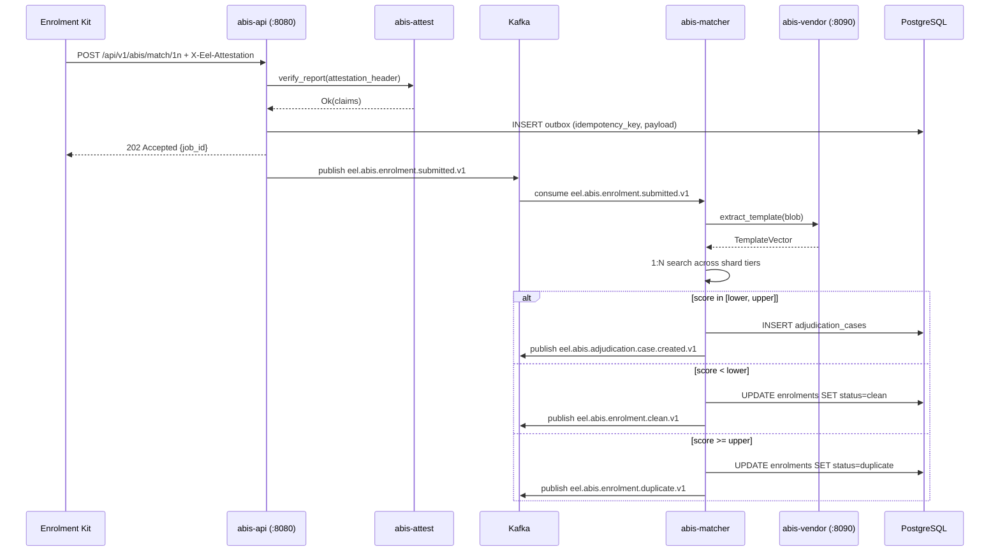

# abis-svc Architecture

## Components

Four Rust crates, one Django console, one Python vendor service, three shard tiers.

| Component | Language | Role |
|---|---|---|
| `abis-api` | Rust/Axum | REST (`:8080`) and gRPC (`:8443`) gateway; idempotency; outbox; event emission |
| `abis-matcher` | Rust | HNSW-backed 1:N and 1:1 scorer; shard router; vendor-router circuit-breaker |
| `abis-attest` | Rust | TDX/SEV-SNP report verification; nonce registry; HSM signer integration |
| `abis-adjudication` | Rust (planned) | Priority queue worker; case FSM; SLA timer |
| Django console | Python/Django | Investigator UI; case assignment; audit trail |
| `abis-vendor` | Python/FastAPI | Pluggable biometric SDK adapter at `:8090`; vendor-router secondary |

## Gallery Layout

Three shard tiers distribute the 22M+ voter gallery across confidential-compute nodes:

```
Tier 1 (hot)   — top 5M subjects by access frequency (HNSW ef=200)
Tier 2 (warm)  — next 10M subjects (HNSW ef=150)
Tier 3 (cold)  — remainder; lazy-loaded from MinIO snapshot (HNSW ef=100)
```

Each tier runs a minimum of 2 replicas (`abis-matcher` pods). The shard router in `abis-matcher` fans out 1:N queries across all tiers and merges candidate lists before threshold scoring.

## HSM Signer

The `abis-attest` crate calls the HSM signer service (`:8444`, mTLS) for:
- Signing STH entries after enrolment batch commit.
- Countersigning adjudication decisions.
- Verifying TDX/SEV measurement values against golden digest stored in OpenBao.

## Enrolment Flow


